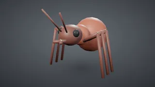
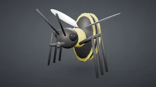
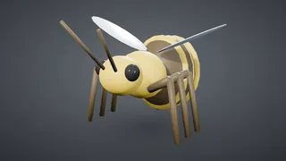
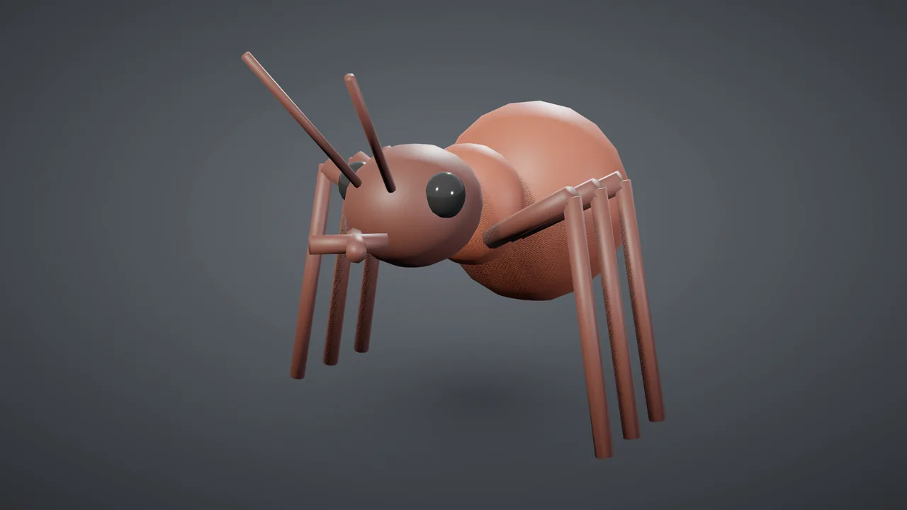
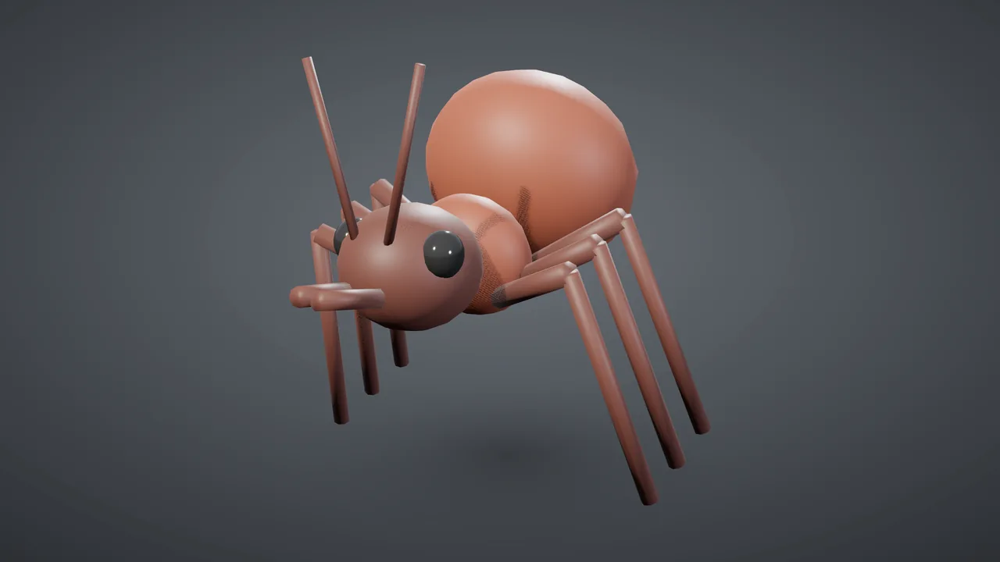
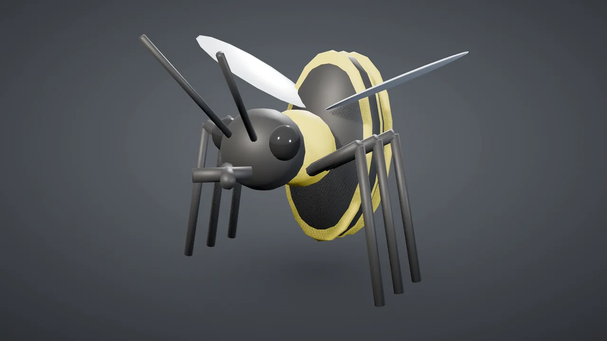
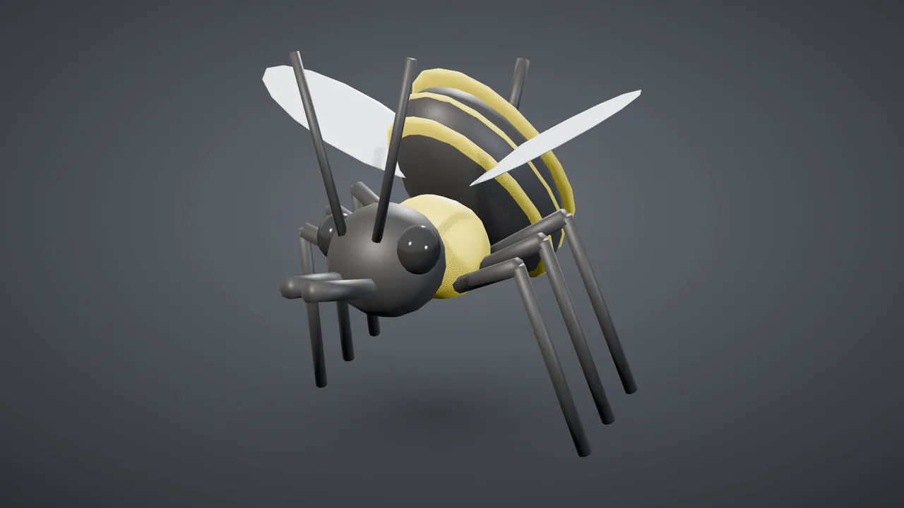
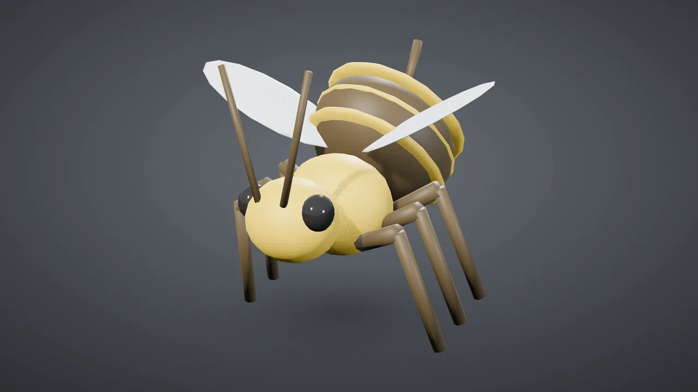

Three human-sized insects for GameSpice games: a soldier ant (a hard bite), a giant wasp (a poisoning sting) and a giant bee (a fast sting). Built on dot-npc and dot-npc-ai, delivered as a pack, and spawnable from any game's spawn menu. Every number is a yml setting.

### In GameSpice, Fatal Contact, Playlot and Zombie Zone

- **GameSpice:** the pack is published to the Workshop as `npc-bugged-up`. Add it to a server's or game's pack list and the bugs appear in the spawn menu (NPC ids `bug_ant`, `bug_wasp`, `bug_bee`); players get it with the server's pack overlay, so there is nothing to install.
- **Zombie Zone:** link the pack into `addons/`. The game's pack scan (`game/zz_packs.gd`) reads `spawn_provider.gd` and adds the bugs to the wave catalogue.
- **Playlot:** link or install the pack and the spawn menu lists the bugs (`game/playlot_addons.gd` reads `spawn_provider.gd`). Set the `bug_host` meta (see [Use](#use)) to have their hits land on players.
- **Fatal Contact:** FC's spawner reads only its own three monsters (`game/fc_npcs.gd`) and loads pack weapons, not pack NPCs, so this pack has no effect there yet.
- **Your own Godot game:** link `addons/npc_bugged_up` beside dot-npc and dot-npc-ai and follow [Use](#use).

<!-- gen_readme:summary -->
| | Bug | Role | Health | Damage |
| --- | --- | --- | --- | --- |
|  | [Soldier Ant](#soldier-ant) | Grunt | 160 | 14 bite |
|  | [Giant Wasp](#giant-wasp) | Poisoner | 90 | 9 sting + poison |
|  | [Giant Bee](#giant-bee) | Swarmer | 120 | 7 sting |
<!-- /gen_readme:summary -->

## Use

Link the pack into a game's `addons/` and let the game's pack scan read `provides.json`. Numbers are in `cfg/addons/npc_bugged_up/*.yml`. The game supplies damage through a host object with `bug_targets()`, `bug_hit(npc, victim, amount, kind, info)` and `bug_status(victim, status, seconds, info)`, set as meta `bug_host` on the `DotNpcSpawner`.

<!-- gen_readme:items -->
## The bugs

### Soldier Ant

*Bite: the head dips and the mandibles close.*

**Grunt** `ant`. The toughest of the three: an armoured soldier ant that walks straight in and bites hard. Slow to kill, easy to outrun.

| Default | |
| --- | --- |
| Health | 160 |
| Speed | 2.6 m/s walking, 5.4 m/s running |
| Bite | 14 damage, 1.7 m reach, every 1.1 s (0.35 s windup) |
| Sight | 28 m, 160 deg cone |
| Hearing | 22 m |
| Weight class | Normal |
| Spawn cost | 2 |
| Body | 1.25 m tall, 0.55 m radius |

### Giant Wasp

*Sting: the abdomen curls forward.*

**Poisoner** `wasp`. The fastest bug, with the longest reach. Each sting is light but poisons the target, so wasps wear a player down while the ants close in.

| Default | |
| --- | --- |
| Health | 90 |
| Speed | 3.2 m/s walking, 6.8 m/s running |
| Sting | 9 damage, 1.9 m reach, every 1.3 s (0.3 s windup); poison for 4 s |
| Sight | 34 m, 180 deg cone |
| Hearing | 26 m |
| Weight class | Normal |
| Spawn cost | 3 |
| Body | 1.2 m tall, 0.5 m radius |

### Giant Bee

*Sting: the abdomen curls forward.*

**Swarmer** `bee`. Cheap, quick and relentless: the weakest sting on the shortest interval. Spawn bees in numbers.

| Default | |
| --- | --- |
| Health | 120 |
| Speed | 2.8 m/s walking, 5.8 m/s running |
| Sting | 7 damage, 1.6 m reach, every 0.9 s (0.25 s windup) |
| Sight | 30 m, 180 deg cone |
| Hearing | 24 m |
| Weight class | Normal |
| Spawn cost | 2 |
| Body | 1.2 m tall, 0.55 m radius |
<!-- /gen_readme:items -->

## Tests and pictures

`./game.sh test` parses every script and runs the suites. `tools/screenshot.sh --all` writes frames to `screenshots/`. `tools/build_bugs.sh` rebuilds the models (Blender 4.x).

<!-- gen_readme:quality -->
## Quality and ongoing improvement

The models, textures, animations, sounds and maps in this pack are improved automatically and recursively by AI agents. [Nightly](https://github.com/gamemann/nightly) keeps a board of improvement items. Agents pick up an item, make the change, render fresh frames and check them with a visual judge. Judge findings become new items, and the loop repeats until the result is production quality. Improvements ship as new pack versions, and the screenshots in this README are re-shot each time. Some assets are still low quality today.
<!-- /gen_readme:quality -->

## Credits

The models are original work, built from primitives by `tools/build_bugs.py`, released CC0-1.0. No third-party art is included. See [CREDITS.md](CREDITS.md) and `licence.json`.
